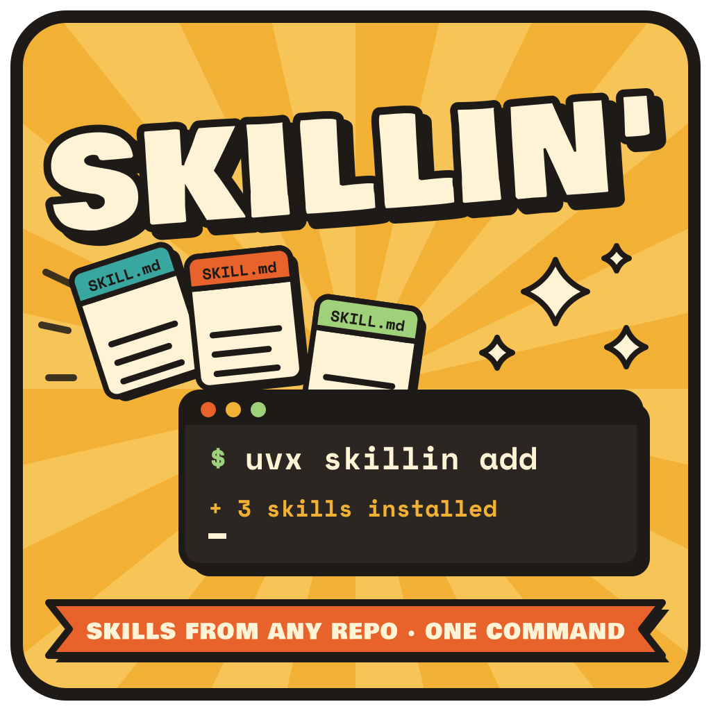

# Skillin



[](https://github.com/jkitchin/skillz/actions/workflows/test.yml)
[](https://github.com/jkitchin/skillz/actions/workflows/lint.yml)
[](https://codecov.io/gh/jkitchin/skillz)


Install AI agent skills, slash commands, subagents, hooks and MCP servers from any git
repository with one command. There's nothing to install first and no repository to clone.
Works with Claude Code, VS Code (GitHub Copilot), Codex, OpenCode, Gemini CLI, Cursor and more.

> **Note:** Currently only tested on Claude Code and OpenCode. Please report issues for other agents.

This repository is both the `skillin` tool and a collection of 44 skills, plus commands, hooks
and agents, for scientific computing, materials science, lab automation and research workflows.

## Install skills from any repo (no setup)

```bash
# List what a repository offers, then install a skill into this project
uvx skillin add jkitchin/skillz --list
uvx skillin add jkitchin/skillz --skill fairchem

# Install for your user (all projects), several skills, no prompts
uvx skillin add jkitchin/skillz -s pycse -s python-plotting -g -y

# Any compatible repo, URL or local path works
uvx skillin add someone/their-skills@their-skill
uvx skillin add https://github.com/o/r/tree/main/skills/foo

# Slash commands, subagents and hooks (installed for Claude Code)
uvx skillin add jkitchin/skillz --command commit --subagent code-reviewer
uvx skillin add jkitchin/skillz --hook black-on-save   # shows the script for review first

# MCP servers, from the repo's .mcp.json, for every selected agent
uvx skillin add someone/repo --mcp their-server -a claude-code -a vscode -a cursor

uvx skillin find plotting   # search skills.sh / GitHub
uvx skillin installed       # everything skillin installed (project + global)
uvx skillin check           # any upstream changes?
uvx skillin upgrade         # apply them
uvx skillin remove fairchem
uvx skillin remove --all    # remove everything skillin installed in this project (-g: global)
```

Until `skillin` is published on PyPI, use
`uvx --from git+https://github.com/jkitchin/skillz skillin add ...`.

- **Compatible with [`npx skills`](https://github.com/vercel-labs/skills):** skills use the same
  repository layout, install locations and lock files, so the two tools can be mixed. A skill
  is copied once to `.agents/skills/<name>`, which VS Code, Codex, OpenCode, Gemini CLI,
  Cursor and Copilot read directly, and symlinked into `.claude/skills/<name>`. With `-g` the same
  happens under `~/`.
- **Tracked:** installs are recorded in `skills-lock.json` (commit it) and
  `.claude/skillin-lock.json`. `check` and `upgrade` use these to find upstream changes.
- **Publish your own:** any git repo with `SKILL.md` files works. Follow the
  [guide to creating compatible skill repositories](docs/publishing-skills.md) and
  check your repo with `uvx skillin validate .`.
- **Shortcuts:** `skillin config set alias.kitchin jkitchin/skillz` lets you write
  `skillin add kitchin -s pycse`.

The `skillz` command still works as an alias of `skillin`.

### Safety

Skills, hooks and MCP servers come from other people's repositories and can run code on
your machine. skillin is careful about what it changes:

- **It never replaces your own files.** If a skill folder, command, subagent, hook or MCP
  server with the same name exists and wasn't installed by skillin (or npx skills), `add`
  lists it and stops. Pass `--force` to replace it.
- **It only removes what it installed.** `remove` refuses names that aren't in a skillin
  lock file unless you pass `--force`. Without a terminal it requires `-y`.
- **You review code that runs.** Hooks and MCP servers must be named explicitly. Their
  scripts or config are shown, with terminal escape codes stripped, and need confirmation
  (or `-y`).
- **It won't corrupt your config files.** `settings.json`, MCP configs and lock files are
  only edited if they parse cleanly; a damaged file stops skillin with a message rather
  than being replaced. Changes are written atomically. `<file>.bak` keeps each file as it
  was before the most recent skillin command, so you may want `*.bak` in `.gitignore`.
- **It stays inside the project.** Symlinked config files are updated in place, which
  keeps dotfiles setups working. In a project, though, skillin refuses any file that links
  outside the project. Lock files record only which agents an MCP server went to, never
  file paths, so a cloned repository's lock can't redirect where skillin writes.
- **Files are confined to the skill.** Only files inside the skill's directory are copied.
  Symlinks pointing outside the repository, and directory symlinks, are skipped. Skill
  scripts are never run during installation.
- **Upgrades show what changed.** `upgrade` lists added, changed and removed files. It asks
  before applying new or changed scripts, and needs `-y` without a terminal.

## MCP servers

`--mcp NAME` installs an MCP server from the source repo's `.mcp.json` (or `mcp/*.json`)
into each selected agent's own config file. Agents come from `-a`, or else from
`default_platform` or detection. skillin translates the config to each agent's format.

| Agent (`-a`) | Project file | Global file (`-g`) | `${VAR}` written as |
|---|---|---|---|
| `claude-code` | `.mcp.json` | via `claude mcp add-json --scope user` | `${VAR}` |
| `vscode` | `.vscode/mcp.json` (`servers`) | VS Code user `mcp.json` | `${env:VAR}` |
| `cursor` | `.cursor/mcp.json` | `~/.cursor/mcp.json` | `${env:VAR}` |
| `codex` | `.codex/config.toml` | `~/.codex/config.toml` | `env_vars`, `bearer_token_env_var`, `env_http_headers` |
| `gemini-cli` | `.gemini/settings.json` | `~/.gemini/settings.json` | `${VAR}` (not verified) |
| `opencode` | `opencode.json(c)` (`mcp`) | `~/.config/opencode/opencode.json` | `{env:VAR}` |
| `github-copilot` | `.mcp.json` | `~/.copilot/mcp-config.json` | `${VAR}` |
| `windsurf` | (global only) | `~/.codeium/windsurf/mcp_config.json` | `${VAR}` (not verified) |

- **Existing files are respected.** A file is only edited if it parses cleanly, and the
  previous version is kept as `.bak`. Files with comments (JSONC) are never rewritten: that
  agent is skipped and skillin prints the snippet to paste yourself. For Codex's TOML, skillin
  appends or removes only the server's own table, and keeps your comments.
- **Project files are only created for agents set up in that project.** Without `-a`, an
  agent needs its folder (e.g. `.vscode/`) to get a project file. Name an agent with `-a` to
  create its file anyway.
- **Untranslatable values are flagged.** If a value can't be expressed for an agent (for
  example `${VAR}` inside Codex `args`), you get a warning instead of a broken config.
- **Removal reaches every place.** `remove --mcp NAME` removes the server from every file it
  was written to. `skillin installed` shows each location and its status.

## Seeing and removing what's installed

`skillin installed` lists everything skillin installed for this project and for your user.
It works offline from the lock files and checks each item is still on disk.
`--untracked` also shows items skillin didn't install: skills and Claude Code
commands, subagents and hooks in agent folders, and MCP servers in every agent's MCP
config. Claude Code's global MCP servers live in `~/.claude.json`, managed by `claude mcp`,
and aren't read; they show as `registered`.

| Installed with | Remove with | What gets removed |
|---|---|---|
| `add -s NAME` (project) | `remove NAME` | `.agents/skills/NAME`, agent links/copies (`.claude/skills/NAME`, ...), lock entry |
| `add -s NAME -g` | `remove NAME -g` | the same under `~/` |
| `add ... -a custom-platform` | `remove NAME [-g]` | the copy in the platform's `skills_dir` / `project_skills_dir` |
| `add --command N` / `--subagent N` | `remove --command N` / `--subagent N` | `.claude/commands/N.md` / `.claude/agents/N.md` |
| `add --hook N` | `remove --hook N` | `.claude/hooks/N/` and every `settings.json` entry for it |
| `add --mcp N` | `remove --mcp N` | the server in every agent config it was written to (see [MCP servers](#mcp-servers)) |
| everything from one repo | `remove owner/repo [-g]` | all of the above that came from that source |
| everything | `remove --all [-g]` | all of the above, in one scope |
| legacy `install` / `hooks install` / `agents install` | `uninstall` / `hooks uninstall` / `agents uninstall` | (not tracked in lock files; `remove NAME --force` also works) |

`remove` only touches things recorded in a lock file. Pass `--force` for anything else.
Other servers in `.mcp.json`, other hooks in `settings.json`, and your own files are left
alone. To uninstall skillin itself, run `uv tool uninstall skillin`. Installed skills stay
until you remove them, so run `skillin remove --all` and `skillin remove --all -g` first if
you want a clean slate.

## Features

- **Remote install**: `add` skills, commands, subagents, hooks and MCP servers from GitHub, GitLab, any git URL or a local path
- **Updates**: `check` and `upgrade` against lock files; `remove` by name or by source
- **Search**: `find` searches skills.sh and GitHub; `search` searches a local skills repository
- **Create**: interactive wizard or AI-assisted creation of skills, commands, hooks and agents
- **Validate**: `skillin validate` checks a repo against the Agent Skills spec and how installers will see it (CI-friendly exit codes)
- **Multi-agent**: Claude Code, VS Code, Codex, OpenCode, Gemini CLI, Cursor, GitHub Copilot, Goose, Windsurf, plus [custom platforms](#custom-platforms)
- **Hooks**: lifecycle hooks for Claude Code (formatting, logging, security, notifications)
- **Skill evolution**: harvest, optimize, A/B test and merge skills (see [docs/cascade.md](docs/cascade.md))

## Installation

You don't need to install anything to use `uvx skillin ...`. To keep `skillin` on your PATH:

```bash
uv tool install skillin          # or: pipx install skillin
# before the PyPI release:
uv tool install git+https://github.com/jkitchin/skillz
```

For development, from a clone of this repository:

```bash
uv pip install -e ".[dev]"
```

## Working with a local skills repository

The commands below work from a local clone of a skills repository, such as this one. Use
them when you are developing skills. For plain installs, `skillin add` (above) is simpler.

### Configure Repository Path

```bash
skillin config set repository /path/to/your/clone
```

### List Available Skills

```bash
# List all skills and commands
skillin list

# List only skills
skillin list --type skill

# List only from repository
skillin list --source repository
```

### Install a Skill

```bash
# Install to Claude Code (default)
skillin install skill-name

# Install to OpenCode
skillin install skill-name --platform opencode

# Install to project directory (.claude/skills/)
skillin install skill-name --target project

# Preview before installing
skillin install skill-name --dry-run
```

### Search for Skills

```bash
skillin search python
skillin search "lab notebook"
```

### Create a New Skill

```bash
# Interactive mode
skillin create --type skill

# With name specified
skillin create --type skill --name my-awesome-skill

# AI-assisted creation using Claude CLI
skillin create --type skill --name my-skill --prompt "A skill for analyzing Python code style"
```

### Uninstall a Skill

```bash
skillin uninstall skill-name
```

### Manage Hooks

```bash
# List available hooks
skillin hooks list --target repo

# Install a hook
skillin hooks install lab-notebook

# Create a hook (with AI)
skillin hooks create my-hook --event PostToolUse --prompt "Format Python with black"
```

### Manage Agents

```bash
# List available agents
skillin agents list --target repo

# Install an agent
skillin agents install code-reviewer

# Create an agent (with AI)
skillin agents create my-agent --prompt "An agent that reviews security vulnerabilities"
```

## Configuration

### Custom platforms

You can add any agent that reads skills from a directory by defining it in the config
file, then use it like a built-in:

```yaml
default_platform: picoclaw        # optional: use it when --platform / -a is omitted
platforms:
  picoclaw:
    skills_dir: ~/picoclaw/docker/data/workspace/skills
    commands_dir: ~/picoclaw/docker/data/workspace/commands
    project_skills_dir: .picoclaw/skills
```

```bash
skillin add jkitchin/skillz -s pycse -a picoclaw -g    # copies, never symlinks
skillin install pycse --platform picoclaw
```

- An unknown platform name is an error. It never falls back to the Claude directories.
- A command that needs a directory you haven't configured, such as `hooks_dir` or
  `project_skills_dir`, tells you which key to set.
- Changing `skills_dir` or `project_skills_dir` for a built-in platform (claude, codex, ...)
  overrides where `skillin add` installs for it.

See [example-config.yaml](example-config.yaml) for every key.

### Config file

Configuration is stored in `~/.config/skillz/config.yaml` (the path keeps the original name
so existing setups keep working).

Default configuration:

```yaml
default_platform: claude

personal_skills_dir: ~/.claude/skills
personal_commands_dir: ~/.claude/commands
project_skills_dir: .claude/skills
project_commands_dir: .claude/commands
default_target: personal
aliases: {}            # e.g. {kitchin: jkitchin/skillz} for `skillin add kitchin ...`

platforms:
  claude:
    skills_dir: ~/.claude/skills
    commands_dir: ~/.claude/commands
  opencode:
    skills_dir: ~/.config/opencode/skills
    commands_dir: ~/.config/opencode/command
  codex:
    skills_dir: ~/.codex/skills
    commands_dir: ~/.codex/commands
  gemini:
    skills_dir: ~/.config/gemini/skills
    commands_dir: ~/.config/gemini/commands
```

## Skills Format

Skills are directories containing a `SKILL.md` file with YAML frontmatter:

```markdown
---
name: my-skill
description: A clear description of what this skill does and when to use it
allowed-tools: ["*"]  # Optional: restrict available tools
---

# Skill Content

Detailed instructions for Claude on how to use this skill...
```

### Requirements

- `name`: lowercase, hyphens only, max 64 characters
- `description`: clear explanation, max 1024 characters
- Directory must contain `SKILL.md`

## Commands Format

Commands are markdown files with optional YAML frontmatter:

```markdown
---
description: Brief description for /help
model: sonnet  # Optional: sonnet, opus, or haiku
allowed-tools: ["*"]  # Optional
argument-hint: <your-arg>  # Optional: autocomplete help
---

# Command Content

Command prompt content here...

Use $ARGUMENTS or $1, $2, etc. for parameters.
```

## Hooks Format

Hooks are directories containing a `HOOK.md` file and a script (`hook.py` or `hook.sh`):

```markdown
---
name: my-hook
description: Brief description of what this hook does
event: PostToolUse  # PreToolUse, PostToolUse, Stop, SessionStart, SessionEnd, etc.
matcher: Write      # Optional: filter by tool name
timeout: 30         # Optional: timeout in seconds
---

# Hook Documentation

Details about when and how this hook runs...
```

### Available Hook Events

- `PreToolUse` / `PostToolUse`: Before/after tool execution
- `UserPromptSubmit`: When user submits a prompt
- `Stop`: When Claude needs user input
- `SessionStart` / `SessionEnd`: Session lifecycle
- `Notification`: For notifications

## Agents Format

Agents are markdown files with YAML frontmatter:

```markdown
---
name: my-agent
description: Clear description of what this agent does
tools: Read, Write, Edit, Grep, Glob
model: sonnet  # sonnet, opus, or haiku
---

# Agent Instructions

Detailed instructions for this specialized agent...
```

## Project Structure

```
skillz/                     # repository (the tool is published as `skillin`)
├── skillin/               # Python CLI package
│   ├── commands/          # CLI command implementations (add.py = add/remove/check/upgrade/find)
│   ├── sources.py         # Parse owner/repo, URLs, local paths
│   ├── fetch.py           # Shallow git clone / GitHub API
│   ├── discovery.py       # Find SKILL.md skills (npx-skills compatible)
│   ├── extras.py          # Commands, subagents, hooks, MCP servers
│   ├── installer.py       # Canonical copy + agent symlinks
│   ├── lock.py            # Lock files
│   ├── agents_registry.py # Supported agents and their paths
│   ├── config.py          # Configuration management
│   ├── validator.py       # Skill/command/hook/agent validation
│   └── utils.py           # Helper functions
├── skills/                # Skill repository
│   ├── academic/
│   ├── programming/
│   └── research/
├── commands/              # Command repository
├── hooks/                 # Hooks repository
│   ├── lab-notebook/
│   ├── prettier-on-save/
│   └── ...
├── agents/                # Agents repository
│   ├── code-reviewer.md
│   ├── debugger.md
│   └── ...
├── templates/             # Templates for new skills/hooks/agents
├── docs/                  # Documentation
└── tests/                 # Test suite
```

## Development

### Setup Development Environment

```bash
# Install with development dependencies
uv pip install -e ".[dev]"

# Install pre-commit hooks
pre-commit install
```

### Pre-commit Hooks

This project uses [pre-commit](https://pre-commit.com/) to automatically run linting and formatting checks before each commit. The hooks will:

- Run `ruff check --fix` to fix linting issues
- Run `ruff format` to format code

If any changes are made by the hooks, the commit will fail. Simply stage the changes and commit again.

### Running Tests

```bash
# Run all tests
pytest

# Run with coverage report
pytest --cov=skillin --cov-report=html
```

### Linting and Formatting

We use [Ruff](https://docs.astral.sh/ruff/) for both linting and formatting:

```bash
# Check for linting issues
ruff check .

# Auto-fix linting issues
ruff check --fix .

# Check formatting
ruff format --check .

# Format code
ruff format .
```

## Available Skills

See the `skills/` directory, or run `uvx skillin add jkitchin/skillz --list`:

- **Programming & materials science**: ASE, pymatgen, VASP, FAIRChem, pycalphad, IDAES, JAX, materials properties, Python best practices, plotting, optimization (single and multiobjective), regression & statistics, Emacs Lisp, Claude-Light
- **Laboratory automation**: Opentrons (API, gripper, heater-shaker, thermocycler, temperature module, magnetic block, absorbance reader)
- **Research**: literature review, scientific data extraction, scientific reviewer, materials databases, scientific workflows, electronic lab notebooks, citation verification, design of experiments, pycse
- **Communication & creative**: scientific writing, presentations, image generation, video storytelling, ElevenLabs audio, brainstorming
- **Development & productivity**: version control, code review, TDD, Ralph Wiggum autonomous loop, troubleshooting, planning
- **Academic**: PhD qualifier review

## Available Hooks

See the `hooks/` directory for available hooks:

- **lab-notebook**: Generate lab notebook entries from Claude Code sessions
- **prettier-on-save**: Auto-format JS/TS/CSS/JSON files with Prettier
- **black-on-save**: Auto-format Python files with Black
- **protect-secrets**: Block writes to sensitive files like .env
- **bash-logger**: Log all bash commands for audit
- **notify-done**: Desktop notification when Claude needs input

## Available Agents

See the `agents/` directory for available agents:

- **code-reviewer**: Analyzes code for quality, security issues, and best practices
- **debugger**: Traces issues through code, analyzes errors, suggests fixes
- **literature-searcher**: Searches academic papers and technical resources
- **test-writer**: Generates comprehensive test cases and suites
- **doc-writer**: Creates documentation, READMEs, and API docs

## Available Commands

See the `commands/` directory for slash commands:

### Git & Workflow
- **/commit**: Generate commit message from staged changes
- **/pr**: Generate PR description from branch commits
- **/changelog**: Generate changelog entry for recent changes

### Code Quality
- **/review**: Quick code review of file or selection
- **/explain**: Explain what code does in plain English
- **/refactor**: Suggest refactoring improvements
- **/fix**: Diagnose and fix a specific error

### Documentation
- **/doc**: Generate docstrings/comments for code
- **/readme**: Generate or update README content
- **/api**: Generate API documentation

### Research
- **/cite**: Format citation from URL or DOI
- **/lab-entry**: Create formatted lab notebook entry
- **/summarize**: Summarize file, PR, or conversation

### Analysis
- **/deps**: Analyze project dependencies
- **/todo**: Extract TODOs from codebase
- **/find-usage**: Find where function/class is used

## Contributing

Contributions are welcome! Please:

1. Follow the skill/command format requirements
2. Add tests for new functionality
3. Update documentation
4. Run linters before submitting

## License

MIT License - see LICENSE file for details

## Support

- Report issues: https://github.com/jkitchin/skillz/issues
- Documentation: https://github.com/jkitchin/skillz#readme

## Related Projects

### Supported Platforms

Skillin manages skills and commands for these AI coding assistants:

- **[OpenCode](https://github.com/sst/opencode)** - The AI coding agent built for the terminal. Open-source, provider-agnostic, with 30k+ GitHub stars.
- **[Claude Code](https://github.com/anthropics/claude-code)** - Anthropic's agentic coding tool that lives in your terminal. Understands your codebase and helps you code faster.
- **[Codex CLI](https://github.com/openai/codex)** - OpenAI's lightweight coding agent that runs in your terminal. See [OpenAI adopts "skills"](https://simonwillison.net/2025/Dec/12/openai-skills/) for details on their skills implementation.
- **Gemini** - Google's AI assistant.
- **VS Code** (GitHub Copilot in VS Code) reads `.agents/skills` and `~/.agents/skills`, so skills installed with `skillin add` work there out of the box; `-a vscode` targets it explicitly.
- Cursor, GitHub Copilot, Goose and Windsurf are supported targets for `skillin add` skills.

### Related Skills Projects

- **[npx skills](https://github.com/vercel-labs/skills)** - Vercel's Node CLI and the [skills.sh](https://skills.sh) directory. `skillin add` follows its layout, install paths and lock files.
- **[openskills](https://github.com/numman-ali/openskills)** - Another universal skills loader (I have not tried this yet).
- **[opencode-skills](https://www.npmjs.com/package/opencode-skills)** - With OpenCode you may get better performance with this plugin (this is what I use). See also the [OpenCode feature request](https://github.com/sst/opencode/issues/3235).

- **[Superpowers](https://github.com/obra/superpowers)** - A complete software development workflow framework for Claude Code with composable skills for design, TDD, code review, and integration. This project was an early motivation to develop this project.

## Credits

Created by John Kitchin for managing AI assistant skills across different LLM platforms.
